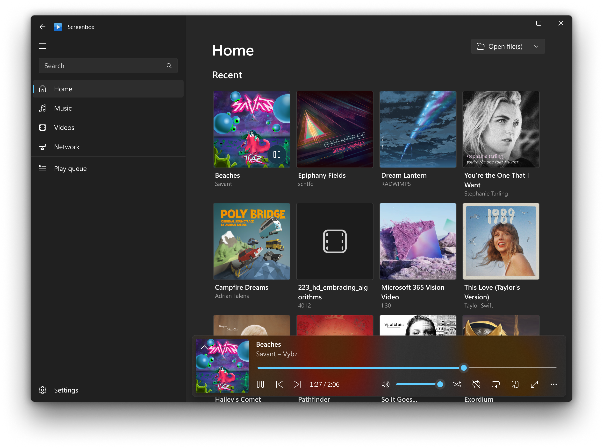
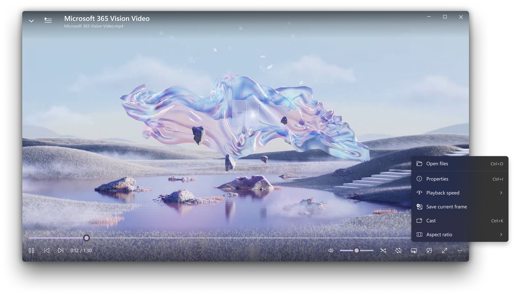

<p align="center">
  
</p>
<h1 align="center">
  FFlux
</h1>
<p align="center">
  The modern media player for Windows
</p>
<p align="center">
  <a href='https://apps.microsoft.com/detail/9NTSNMSVCB5L?cid=storebadge&mode=mini'>
    <picture>
      <source media="(prefers-color-scheme: dark)" srcset="https://get.microsoft.com/images/en-us%20light.svg">
      <source media="(prefers-color-scheme: light)" srcset="https://get.microsoft.com/images/en-us%20dark.svg">
      
    </picture>
  </a>
</p>

FFlux is a modern video player that cares about performance and ease of use on a wide range of device types. It features a beautiful, friendly user interface that is fast and lightweight. FFlux is available on Windows 10 version 1903 and up and Windows 11.

FFlux is built on top of [FFmpegInteropX](https://github.com/ffmpeginteropx/FFmpegInteropX) and the Universal Windows Platform (UWP).

<picture>
  <source media="(prefers-color-scheme: dark)" srcset="/assets/images/docs/PC-HeroHomePage-Dark.png?raw=true">
  <source media="(prefers-color-scheme: light)" srcset="/assets/images/docs/PC-HeroHomePage-Light.png?raw=true">
  
</picture>



Some notable features:

- Fluent design user interface
- Gesture support for seeking and changing volume
- Window resize hotkeys (number row `1`-`4`)
- YouTube-inspired hotkey layout
- Picture-in-picture mode
- Save the video frame as an image
- Chromecast support
- Browse and play media over the network

And many more on the way!

## Install

The recommended way to install FFlux is through the [Microsoft Store](https://www.microsoft.com/store/apps/9NTSNMSVCB5L). Installing through the store ensures the app stays up to date automatically. You don't need a Microsoft account to download apps from the store. The app can also be installed through winget using the following command.

```shell
winget install screenbox -s winget
```

## Contribute

Feel free to open an issue if you want to report a bug, give feedback, or ask a question. PRs are very welcome!

### For Contributors

- 📖 **[Contributing Guide](CONTRIBUTING.md)** - Complete guide for new contributors
- 🏗️ **[Project Structure](docs/PROJECT_STRUCTURE.md)** - Detailed codebase architecture overview

### Quick Start for Developers

1. **Prerequisites**: Visual Studio 2026 with UWP development workload
2. **Clone**: `git clone https://github.com/huynhsontung/Screenbox.git`
3. **Build**: Open `FFlux.slnx` and build the solution (Ctrl+Shift+B)
4. **Run**: Set platform to x64 and start debugging (F5)

See the [Contributing Guide](CONTRIBUTING.md) for detailed setup instructions.

## Translation

[](https://crowdin.com/project/screenbox)

Help translate the app to your language on [Crowdin](https://crowdin.com/project/screenbox)! Crowdin offers an intuitive UX for you to get started and is the recommended tool for localization. Translations are automatically synced to GitHub and published in the next minor update.

You can also translate the app locally without Crowdin. The project source language is English, United States. All localizable source files are in the `FFlux\Strings\en-US` directory. Localizable file types are `.resw` and `.md`.

Make sure you have your translations in the appropriate folder under the `FFlux\Strings` directory. We use a [IETF language tag](https://www.venea.net/web/culture_code) to name the folder that contains resources for that language (e.g. `fr-FR` for French (France), `es-ES` for Spanish (Spain)). Files in these folders are translated copies of the original resource files in `FFlux\Strings\en-US`.

A typical workflow for translating resources:

1. Fork and clone this repo.
1. Create a folder for your language under `FFlux\Strings` if there isn't one already.
1. Copy over any missing files from the `en-US` folder. 
1. Translate the `.resw` and `.md` files in the directory.
1. Once you're done, commit your changes, push to GitHub, and make a pull request.
